<div align="center">

# sd-gunracks

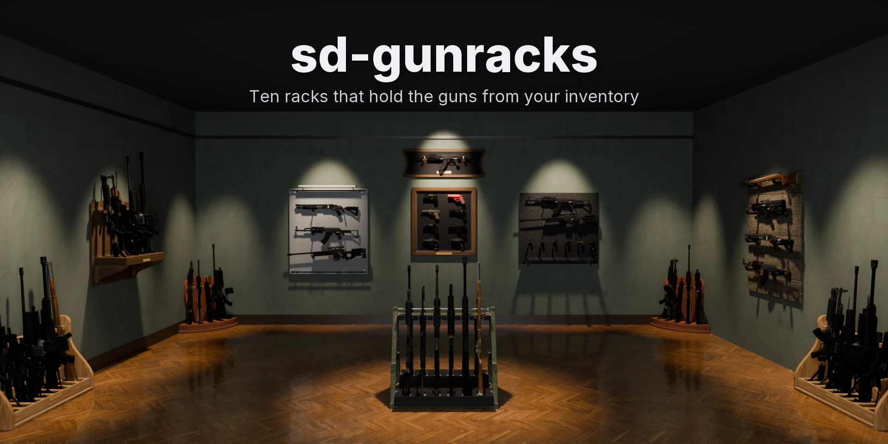

sd-gunracks adds ten gun racks to FiveM that players place themselves: on the floor, on a wall or on a table. A rack holds the real weapons from the player's inventory. Each one is drawn in its slot as the game's own model with its attachments and tint, and it keeps its serial, ammo and components until someone takes it back out. Racks lock, open to chosen jobs and gangs, can be forced with a lockpick, and police can seize from them. Staff get a full console.

[](https://github.com/Samuels-Development/sd-gunracks)
[](https://discord.gg/FzPehMQaBQ)


[**Store**](https://fivem.samueldev.shop) · [**Discord**](https://discord.gg/FzPehMQaBQ)

**Works together:** **sd-gunracks** · [**sd-interact**](https://github.com/Samuels-Development/sd-interact)

</div>

---

## Support Me

If you're enjoying sd-gunracks and want to support my work, consider picking up a script from [Samuel's Development](https://fivem.samueldev.shop). Every purchase helps me keep building and improving free resources like this one.

## Screenshots

The racks are rendered in Blender from the models this resource streams, loaded with the game's own weapon models at the exact positions the resource puts them in. The console and the placer's strip are captured from their page with sample data. Click an image for the full 1920×1080 version.

<p align="center"><a href="docs/previews/01-gun-room.webp">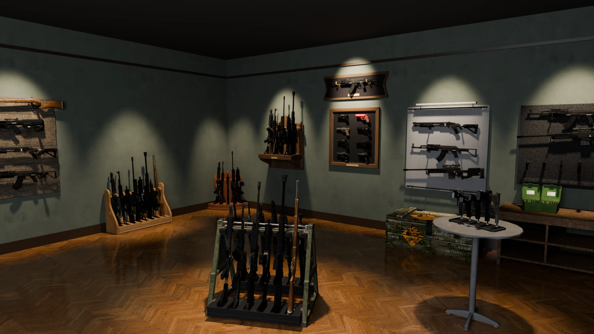</a></p>

<p align="center"><a href="docs/previews/02-floor-racks.webp">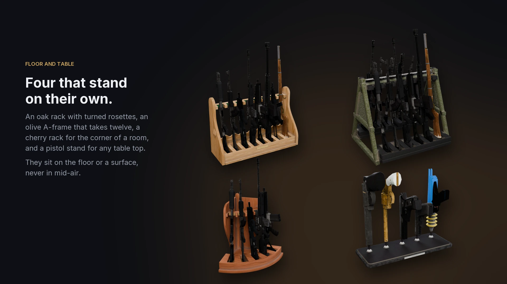</a></p>

<p align="center"><a href="docs/previews/03-wall-racks.webp">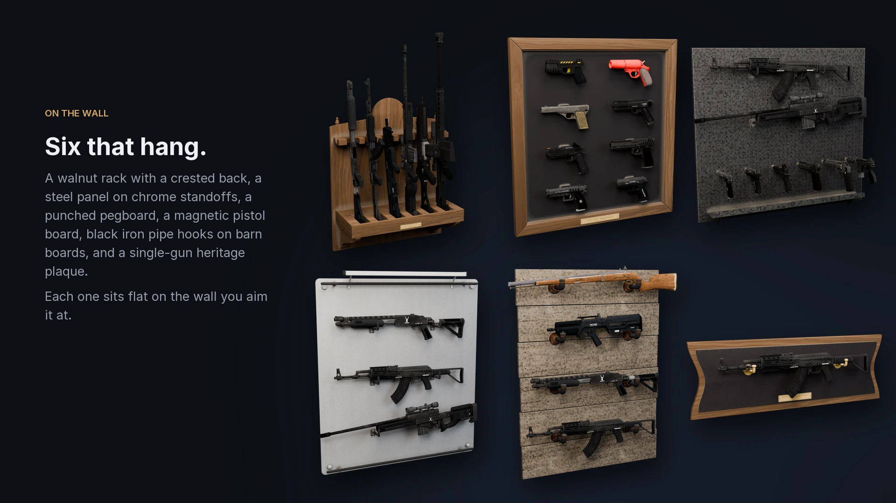</a></p>

<p align="center"><a href="docs/previews/04-real-fits.webp">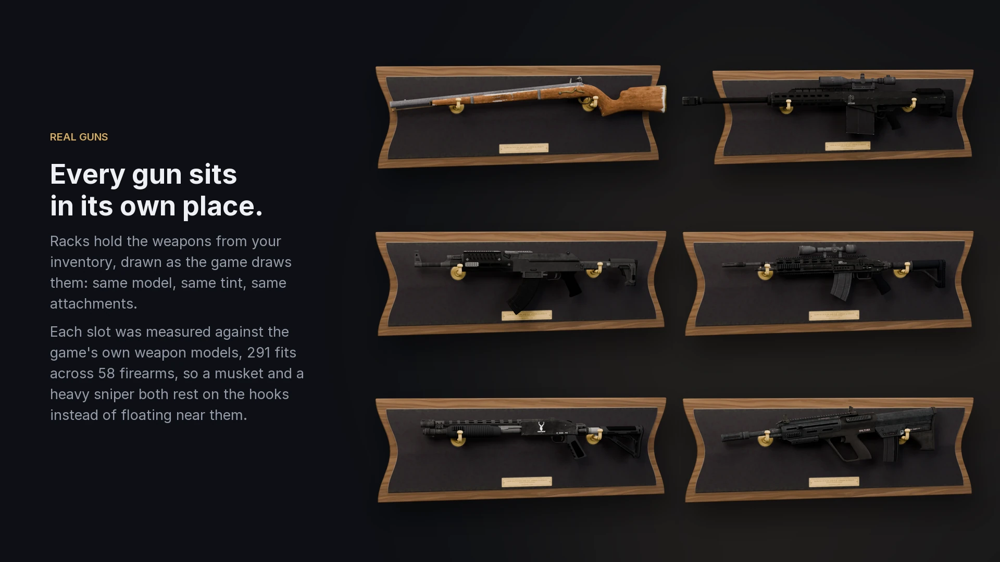</a></p>

<p align="center"><a href="docs/previews/06-placing.webp">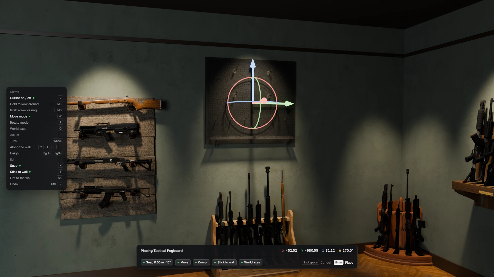</a></p>

<p align="center"><a href="docs/previews/05-console.webp">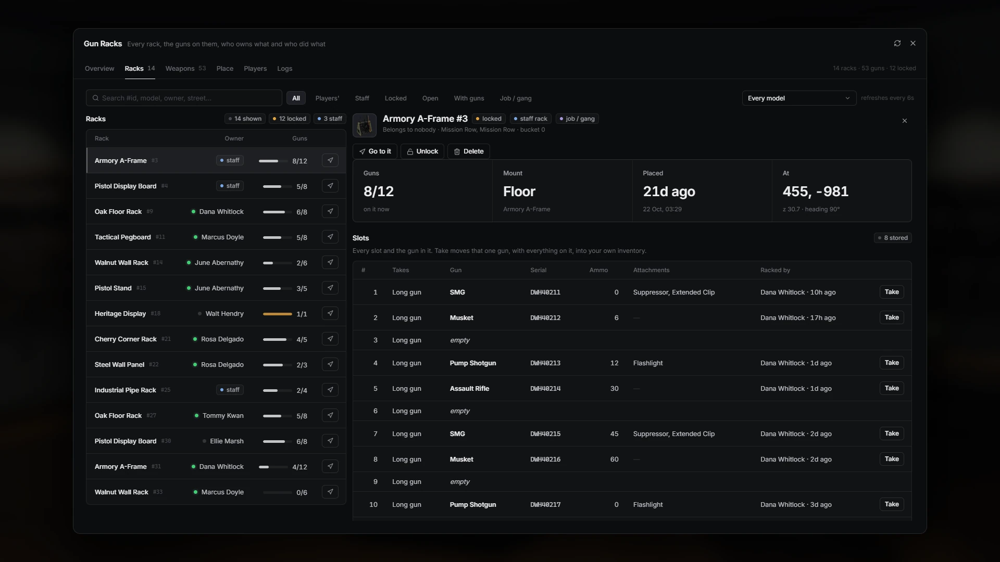</a></p>

<table>
<tr>
<td width="50%"><a href="docs/previews/05-console-overview.webp">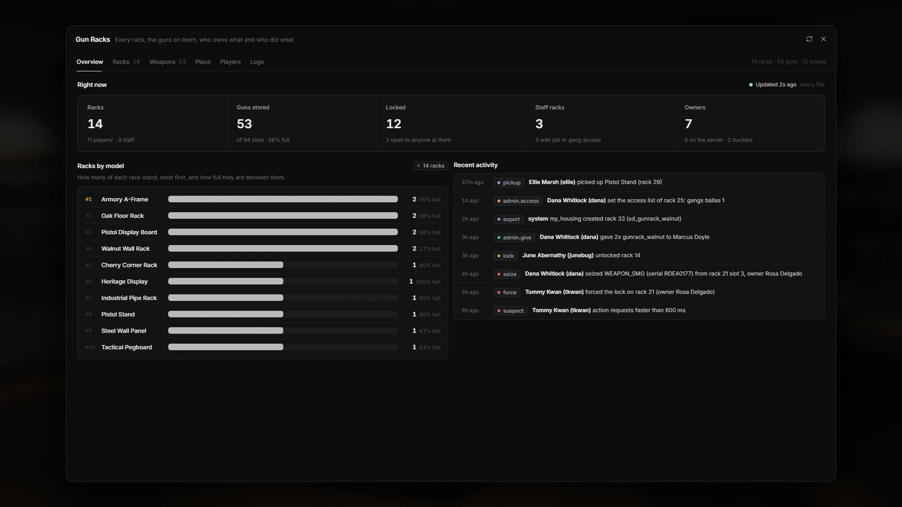</a></td>
<td width="50%"><a href="docs/previews/05-console-weapons.webp">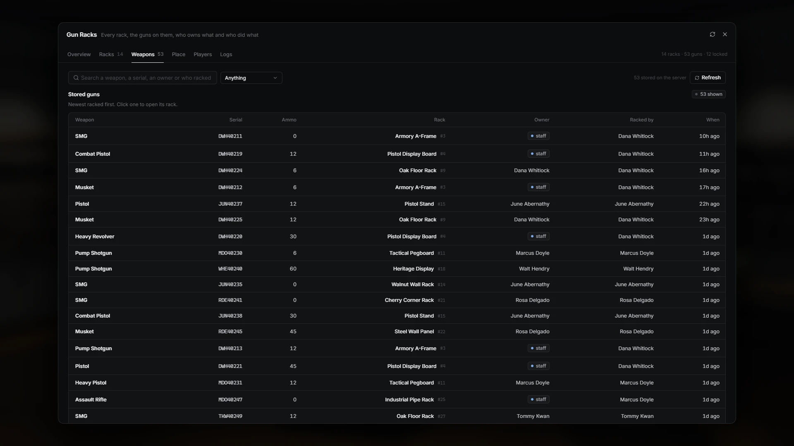</a></td>
</tr>
<tr>
<td width="50%"><a href="docs/previews/05-console-place.webp">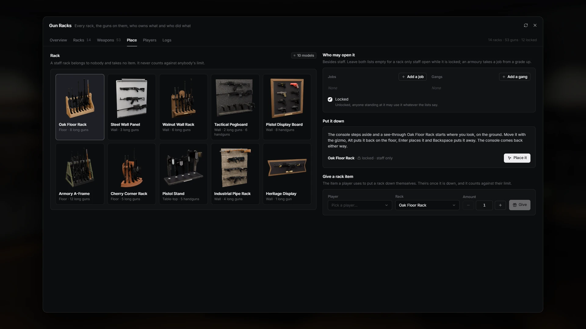</a></td>
<td width="50%"><a href="docs/previews/05-console-logs.webp">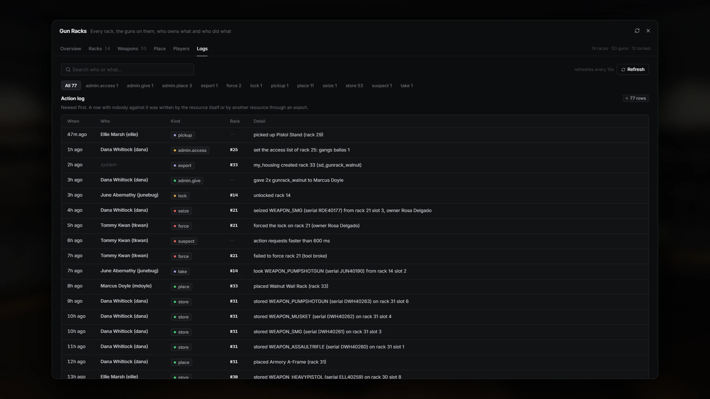</a></td>
</tr>
</table>

<p align="center"><a href="docs/previews/07-with-sd-interact.webp">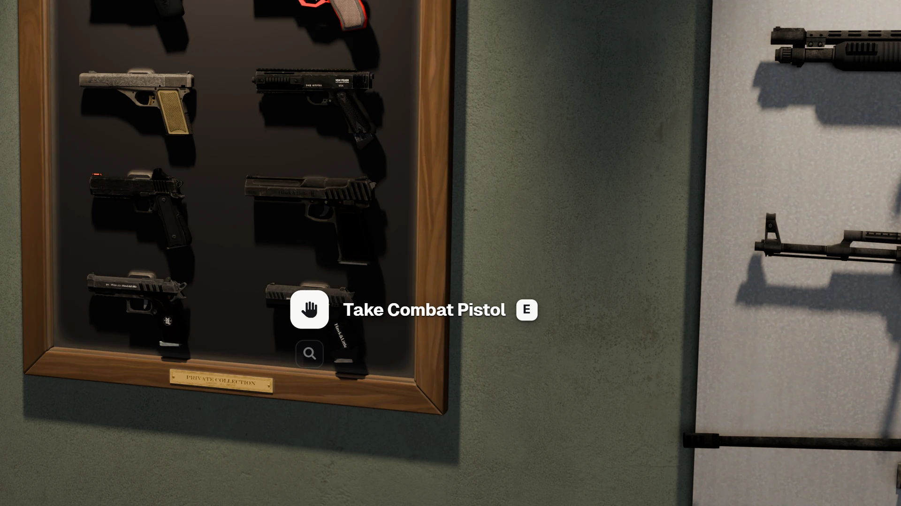</a></p>

---

> [!TIP]
> **Running [sd-interact](https://github.com/Samuels-Development/sd-interact)?** Every slot gets its own floating prompt ("Take Combat Pistol", "Rack Assault Rifle") instead of a target eye, and the racks switch to it by themselves when it starts.

## Highlights

- **Ten racks.** Four that stand (an oak floor rack, an olive A-frame that takes twelve, a cherry corner rack, a table-top pistol stand) and six that hang (a walnut rack, a steel panel, a tactical pegboard, a magnetic pistol board, a pipe rack, a single-gun heritage plaque). 60 slots between them, each model with its own baked textures.
- **The real gun, in its place.** Every slot was measured against the game's own weapon models: 291 fits across 58 firearms, from the musket to the heavy sniper. A gun rests on its hooks or stands in its notch instead of floating near them. Addon weapons fall back to a fit worked out from their size.
- **Nothing is lost.** A racked gun keeps its serial, ammo, durability, attachments and tint, and comes back out exactly as it went in.
- **Placing with the gizmo.** A see-through rack appears where you look, flat on the wall you aim at or on the floor under you. Drag it with the game's editor gizmo, snap it, and press Enter. It turns red, with the reason, wherever it can't go.
- **Who may use it.** Racks start locked to their owner. Unlock one for everyone nearby, or have staff open it to jobs and gangs from a chosen grade.
- **Forcing and seizing.** A lockpick and a skill check open someone else's locked rack, and the police get an alert through your dispatch resource. Police jobs can seize any gun, and each seizure is logged with the serial and the owner.
- **A staff console.** `/gunracks` lists every rack and every stored gun on the server. Staff can open a rack, go to it, unlock it, change its access, take one gun, give the rack to a player or delete it, place staff racks anywhere, hand out rack items, and read the full audit log.
- **Safe by design.** Every request is checked, paced and logged on the server. A rack is written to the database before any gun changes hands, so a failed save never duplicates or destroys a weapon.

## The racks

| | Item | Rack | Mount | Slots |
|---|---|---|---|---|
| 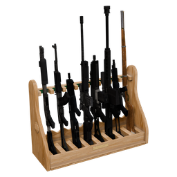 | `gunrack_oak` | Oak Floor Rack | floor | 8 long guns |
| 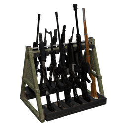 | `gunrack_armory` | Armory A-Frame | floor | 12 long guns |
| 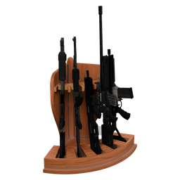 | `gunrack_corner` | Cherry Corner Rack | floor, in a corner | 5 long guns |
| 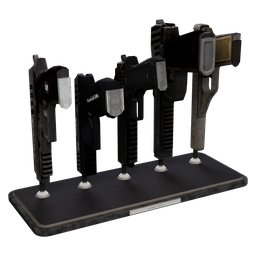 | `gunrack_stand` | Pistol Stand | table top | 5 handguns |
| 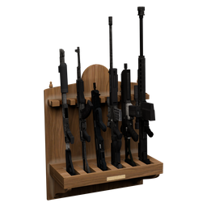 | `gunrack_walnut` | Walnut Wall Rack | wall | 6 long guns |
| 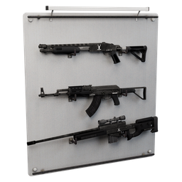 | `gunrack_panel` | Steel Wall Panel | wall | 3 long guns |
| 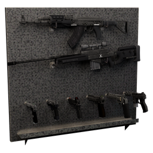 | `gunrack_pegboard` | Tactical Pegboard | wall | 2 long guns, 6 handguns |
| 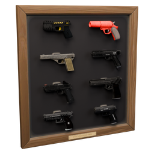 | `gunrack_pistols` | Pistol Display Board | wall | 8 handguns |
| 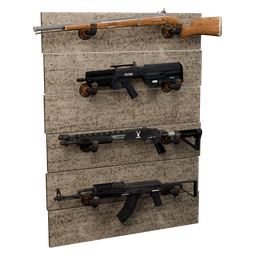 | `gunrack_pipe` | Industrial Pipe Rack | wall | 4 long guns |
| 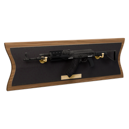 | `gunrack_heritage` | Heritage Display | wall | 1 long gun |

## Compatibility

| Layer | Supported |
|---|---|
| Frameworks | QBCore, QBox, ESX (auto-detected) |
| Inventories | ox_inventory, qb-inventory, qs-inventory, ps-inventory, lj-inventory, codem-inventory, tgiann-inventory, origen_inventory, jaksam_inventory, one_inventory (auto-detected) |
| Target | [sd-interact](https://github.com/Samuels-Development/sd-interact) when it runs, otherwise ox_target, qb-target or qtarget |
| Dispatch | cd_dispatch, ps-dispatch, qs-dispatch, linden_outlawalert, core_dispatch, fd_dispatch, codem-dispatch, tk_dispatch, origen_police |

Racks follow routing buckets: players only see and use the racks in their own bucket. A gun keeps its serial, attachments and ammo on inventories that store weapon metadata.

## Installation

It needs OneSync, [ox_lib](https://github.com/CommunityOx/ox_lib) and [oxmysql](https://github.com/CommunityOx/oxmysql). Start them, your framework, your inventory and your target first:

```cfg
ensure ox_lib
ensure oxmysql
ensure sd-gunracks
```

1. Add the ten rack items from [items.md](items.md) to your inventory, and copy the pictures in `images/` into its image folder.
2. Start the server. The `sd_gunracks` and `sd_gunracks_log` tables create themselves.
3. Go through `configs/`. The settings players must not see are in `configs/server/`, which never reaches a client.

## Configuration

| File | What's in it |
|---|---|
| `configs/shared/racks.lua` | The item name for each rack model |
| `configs/shared/placement.lua` | How far you can place from yourself, spacing between racks |
| `configs/shared/weapons.lua` | Addon weapons (by group) and a blacklist of weapons that may never be racked |
| `configs/shared/interact.lua` | How close you must be to use a rack |
| `configs/server/placement.lua` | Racks per player (10 by default), which jobs may place them |
| `configs/server/interact.lua` | Forcing the lock (item, skill check, police alert) and which police jobs may seize |
| `configs/server/admin.lua` | The console command, who may open it, request pacing |
| `configs/server/logs.lua` | How long the audit log is kept |
| `configs/client/controls.lua` | The placer's keys and its snap and nudge steps |
| `configs/client/targets.lua` | Option icons and distances, and whether to use sd-interact (`'auto'`, `true`, `false`) |

## Playing

- **Placing.** Use a rack item and the rack appears where you look. Then:

  | Key | |
  |---|---|
  | `G` | Cursor on or off, for the gizmo |
  | Left mouse / right mouse | Grab an arrow or a ring / hold to look around |
  | `W` / `R` / `Q` | Move mode / rotate mode / world or local axes |
  | Mouse wheel | Turn (`Shift` 15°, `Ctrl` 1°) |
  | Arrows, `PgUp` / `PgDn` | Nudge (a wall rack slides along its wall), height |
  | `X` / `T` / `Alt` | Snap on or off / stick to the wall or floor / back flat onto it |
  | `Ctrl+Z` / `Ctrl+Y` | Undo / redo |
  | `Enter` / `Backspace` | Place / cancel (the item stays in your inventory) |

- **Storing.** Hold a gun and look at an empty slot: "Rack Assault Rifle". Or choose any gun you carry that the slot takes.
- **Taking and inspecting.** Look at a racked gun. Inspect shows its serial, ammo, attachments, and who racked it and when.
- **Your rack.** Lock it, unlock it for anyone nearby, or pick it up once it's empty.

Staff open the console with `/gunracks`: group.admin, or anyone given the `sd-gunracks.admin` ace.

## Exports (server)

Exports that change racks write to the database, so call them from a thread (an event handler or `CreateThread`).

```lua
-- Every rack / one rack, as copies (stored guns with their full metadata).
local racks = exports['sd-gunracks']:GetRacks()
local rack = exports['sd-gunracks']:GetRack(id)

-- Create a rack without an item. coords: the rack's origin (floor racks on the floor under the middle of the
-- footprint, wall racks on the wall at the bottom-centre of their back).
-- opts (all optional): bucket (default 0), owner (character id), ownerName, locked (default true),
-- access = { jobs = { police = 0 }, gangs = { ballas = 2 } }, ignoreSpacing = true.
local id, err = exports['sd-gunracks']:CreateRack('sd_gunrack_oak', coords, heading, opts)

-- Delete a rack. With giveTo (a player's server id) its guns go into that player's inventory, and the rack is
-- kept if they can't carry them all. Without it, the guns are returned to you.
local ok, guns = exports['sd-gunracks']:DeleteRack(id, giveTo)
```

On failure the second value is one of `bad_model`, `bad_coords`, `too_close`, `overlap`, `save_failed`, `no_rack`, `busy`, `cannot_carry`.

## For developers

### The console

The staff console and the placer's strip are a React page in `web/`. The built page ships in `web/build`.

```bash
cd web
npm ci
npm run dev     # in a browser with sample data: /?admin for the console, /?placer for the strip
npm run build   # what the game serves (web/build)
```

### Rebuilding the racks

`stream/` holds the ten models and `sd_gunracks.ytyp`. `data/racks.json` holds every slot and every weapon fit, and `images/` holds the inventory pictures. They are all built by `tools/props/` in Blender 5 with the Sollumz extension: modelling, baking, fitting every vanilla firearm into every slot against its real mesh, and checking that no gun goes into its rack. [tools/props/readme.md](tools/props/readme.md) has the steps and the frames each rack is built in. [docs/contract.md](docs/contract.md) covers how the models and the script meet.

### Tests

`lua tests/run.lua` runs the server logic offline under stock Lua 5.4: placing, storing, taking, access, forcing, seizing, the console and the exports, with the framework, inventory and database faked.

## Licence

GPL-3.0. Textures, fonts and other third-party material are listed in [THIRD_PARTY_NOTICES.md](THIRD_PARTY_NOTICES.md).
